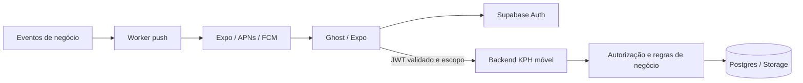

# Arquitetura

Status: Fase 1A local e Fase 1B no ambiente de desenvolvimento implementadas. Ghost é um cliente do KPH; não copia Server Actions, cookies do shell ou tabelas web para o celular. Veja a [entrega 1B](phase-1b.md).

## Componentes e dependências

Expo + React Native + TypeScript estrito, Expo Router para rotas e links; TanStack Query para dados remotos; Supabase JS para Auth; SecureStore para sessão; Local Authentication para bloqueio local opcional; Notifications para registro e recepção push; Zod para respostas remotas. Componentes React Native próprios evitam dependência de UI web. Dependências têm versões exatas e lockfile.

EAS Build/Submit ficam preparados, sem publicação. Perfis development/preview/production e schemes distintos estão configurados; projeto EAS, IDs definitivos e credenciais ainda faltam. OTA permanece desativado. Segredos de assinatura e push ficam no serviço de build/backend, nunca em EXPO_PUBLIC.

```text
app/                         rotas públicas, callback e árvore autenticada
src/ui/                      tokens, componentes e estados
src/features/                auth, contexto, pendências, perfil, notificações
src/domain/                  tipos e estados; sem fórmulas financeiras duplicadas
src/contracts/               schemas validados das respostas do backend
src/data/                    clientes, repositories e query keys
src/security/                guards, SecureStore e bloqueio local
src/notifications/           registro, navegação e preferências
src/telemetry/               eventos permitidos e redaction
```

## Fronteira de confiança



Backend valida token e sessão, usuário ativo, capacidade, unidade e pertença do recurso a cada request. Server role somente em operações internas minimizadas após autorização. Revalidar papéis nas ações sensíveis; não confiar em claims desatualizadas. App oculta módulos sem capacidade, mas isso é UX. Uma rota ou ID vindo por push não concede acesso.

## Sessão e contexto

Estados explícitos: inicializando → deslogado → autenticando → carregando vínculo → pronto. Alternativas: sessão expirada, sem vínculo, inativo, indisponibilidade de rede, bloqueio local. Erro de rede não equivale a revogação. Sem vínculo ou inativo não recebe dados de negócio.

SecureStore persiste sessão com tratamento de falha/tamanho e renovação serializada; validar suporte/tamanho real de tokens na implementação. Não oferecer fallback para armazenamento inseguro. Controlar auto-refresh pelo estado foreground/background do app. Biometria é desbloqueio local opcional, não autenticação do backend; cancelar biometria mantém bloqueado, mudança de cadastro exige novo login. Ocultar conteúdo sensível no app switcher e ao bloquear.

Unidades e capacidades vêm do bootstrap autenticado `ghost_bootstrap_v1`. Seleção hierárquica grupo/marca/unidade respeita vínculos; a seleção é revalidada. Nunca selecionar unidade arbitrária em resposta a erro de autorização. O backend não concede fallback por escopo nulo.

Ao trocar unidade: bloquear ações, incrementar geração do contexto, cancelar consultas, remover cache anterior, validar nova unidade, carregar dados. Chaves incluem usuário, unidade, recurso e parâmetros; respostas atrasadas são descartadas. Não mostrar dados da unidade anterior durante loading. Mudança de permissões repete o mesmo processo.

Logout: desativar vínculo push com autenticação ainda válida quando houver rede; invalidar sessão no servidor quando possível; cancelar requests, limpar cache e SecureStore, limpar contexto/link pendente. Falha de rede não pode impedir limpeza local. Revogação pendente do dispositivo será coberta por expiração de vínculo e revalidação pelo backend; não afirmar desligamento remoto sem confirmação.

## Deep links e recuperação

Schemes por ambiente são `ghost-local`, `ghost-preview` e `ghost-production`. Recuperação usa PKCE e `/auth/reset-password`; os três redirects nativos estão cadastrados no painel Auth do desenvolvimento e o redirect web canônico é `https://app-ceo-hos.vercel.app/auth/reset-password`. Eles ainda precisam ser validados por e-mail real. Callback de recuperação abre estado exclusivo de redefinição e não concede acesso a dados. Links de conteúdo usam allowlist de destinos internos; após login, bootstrap e capability são revalidados. Links pendentes são limpos no logout.

## Dados, offline e falhas

Cache de negócio somente em memória nesta fundação; preferência de tema pode persistir. Exibir horário de atualização, estado de cache e falta de conexão. Escritas financeiras e aprovações exigem conexão e confirmação; não enfileirar offline. Retentar leituras transitórias com limite/backoff; 401 tenta renovação uma vez, 403 limpa acesso e não faz retry, 409 pede atualização, 429 respeita Retry-After. Nunca repetir mutações sem chave idempotente e contrato do servidor.

Contratos possuem versão, requestId, escopo, timestamps e estados de ausência de dados. Valores monetários transportados como centavos inteiros dentro de limites seguros ou strings decimais especificadas pelo backend; não parsear moeda com parseFloat. Datas civis ISO separadas de instantes UTC; exibir pt-BR e timezone da unidade quando definido. Telemetria permite nome do evento, duração e código de erro; proíbe JWT, e-mail, salários, payloads e documentos.

## Push

Backend gera eventos; app não decide vencimento/risco de meta. Registro associa usuário autenticado, instalação, plataforma, token e ambiente; suporta múltiplos aparelhos, rotação, expiração e remoção de token inválido. Sem backend de registro validado, não mostrar push como ativo.

Categorias iniciais: aprovação, vencimento/atraso a pagar/receber, falha de integração, auditoria, fechamento diário, metas, ausência/atraso/falta, férias/hora extra e vencimento documental. Preferências por categoria e horário silencioso por timezone; backend verifica unidade e permissão tanto no envio quanto na abertura.

Evento persistido → deduplicação por evento/usuário/dispositivo → fila → envio → receipt → invalidação quando DeviceNotRegistered. Estados distinguem enfileirado, enviado ao provedor, falhou e aberto informado pelo app. Receipt de provedor não prova leitura nem entrega visível; só registrar entregue se houver evidência suportada. Histórico interno não depende de push permitido. Payload visível genérico, ID opaco e versão, sem valores financeiros/pessoais. Solicitar permissão após login com explicação; testar em development build e dispositivo real.
